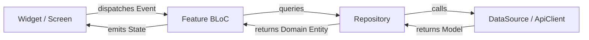

# TVMaze Stream - Flutter BLoC Application

[](https://flutter.dev)
[](https://dart.dev)
[](#architecture-overview)
[](https://bloclibrary.dev)
[](#test-suite--validation)

A production-grade, highly polished television exploration mobile application developed using **Flutter** and the **BLoC (Business Logic Component)** state management pattern, powered by the public [TVMaze REST API](https://www.tvmaze.com/api).

---

## Table of Contents
1. [Key Features](#key-features)
2. [Aesthetic & Design System](#aesthetic--design-system)
3. [Architecture Overview](#architecture-overview)
4. [Unidirectional Data Flow](#unidirectional-data-flow)
5. [Project Structure](#project-structure)
6. [Getting Started & Running Locally](#getting-started--running-locally)
7. [Test Suite & Validation](#test-suite--validation)
8. [Examiner Viva Defense Guide](#examiner-viva-defense-guide)

---

## Key Features

- **Discover & Home Feed**:
  - Synthesized **"Trending Now"** horizontal carousel showcasing the top 10 highest-rated shows from the catalog with gradient overlays and rating badges.
  - Infinite-scrolling **"Popular Shows"** grid with page-by-page lazy loading (`/shows?page=X`) and `hasReachedMax` terminal guard.
  - Shimmer placeholder skeletons for zero layout pop-in.
  - Pull-to-refresh (`RefreshIndicator`) re-fetching from page 0.

- **Dynamic Debounced Search**:
  - Live query field with clear button.
  - **500ms reactive debounce transformer** via `rxdart` (`debounceTime` + `distinct` + `switchMap`) preventing API spam.
  - Dedicated initial guidance view ("Discover TV Shows"), empty zero-results state ("No shows found"), and error recovery views.

- **Comprehensive Show Details**:
  - Hero backdrop image with smooth top-to-bottom dark gradient fade.
  - Live metadata badges: star rating, premiered-ended years, running status, and network attribution.
  - HTML sanitizer utility safely stripping formatting from synopses.
  - **Concurrent multi-endpoint retrieval** via `Future.wait`: loads show metadata, cast members (`/shows/{id}/cast`), and episodes (`/shows/{id}/episodes`) in parallel.
  - Interactive **Season Selector** dropdown grouping episodes dynamically into sorted season buckets.
  - Cast tab displaying photos, real names, and character roles.

- **Offline Watchlist Persistence & Sync**:
  - Add or remove any show with a single tap from either the Details view or the Watchlist screen.
  - Offline persistence using `SharedPreferences` with JSON serialization under `watchlist_shows_v1` and corruption-resilient parsing.
  - App-level `WatchlistBloc` mounted above `MaterialApp` for real-time cross-screen synchronization.
  - Swipe-to-dismiss deletion with undo feedback, clear-all modal, and glowing empty state with an "Explore Shows" deep-link button.

- **Student Viva & Project Profile**:
  - Dedicated 4th tab displaying student credentials, live calculated watchlist statistics (count, average rating, top genre), architecture breakdown, and TVMaze API attribution.

---

## Aesthetic & Design System

The application features a modern dark aesthetic with neon violet accents:

| Token | Hex Value | Usage |
|---|---|---|
| `AppColors.background` | `#0F1016` | Global scaffold background |
| `AppColors.surface` | `#161822` | Navigation bar, modal sheets |
| `AppColors.surfaceVariant` | `#1E2030` | Search fields, chip containers |
| `AppColors.cardBg` | `#1A1B2E` | Show cards, episode tiles |
| `AppColors.primary` | `#8B5CF6` | Primary action buttons, active tabs |
| `AppColors.primaryLight` | `#A855F7` | Glowing accents, highlights |
| `AppColors.rating` | `#FBBF24` | Star rating badges |
| `AppColors.error` | `#EF4444` | Error states, destructive actions |

Modern typography is provided by `google_fonts` using **Poppins**.

---

## Architecture Overview

The codebase is structured following **Feature-First Clean Architecture**:

```
lib/
├── core/                       # Shared cross-cutting concerns
│   ├── constants/              # API endpoints, debounce timings, storage keys
│   ├── errors/                 # Typed exceptions (Network, Server, NotFound)
│   ├── network/                # ApiClient wrapping http with 15s timeout
│   ├── theme/                  # AppColors and AppTheme dark ThemeData
│   ├── utils/                  # HTML stripper, date formatters
│   └── widgets/                # Reusable UI primitives (Shimmer, ErrorView, RatingBadge)
│
└── features/                   # Autonomous feature modules
    ├── shell/                  # Persistent bottom navigation with IndexedStack
    ├── shows/                  # Home feed, trending carousel, popular shows grid
    ├── search/                 # Debounced search bar, live results, empty state
    ├── details/                # Show details, episode grouper, cast members
    ├── watchlist/              # Local storage, SharedPreferences data source, WatchlistBloc
    └── profile/                # Student credentials, live metrics, API attribution
```

Each feature adheres to a 3-layer architecture:
1. **Data Layer (`data/`)**: Models with JSON serialization, Remote/Local DataSources, and Repositories.
2. **Business Logic Layer (`bloc/`)**: BLoC, Events, and States inheriting from `Equatable`.
3. **Presentation Layer (`presentation/`)**: Screens, slivers, and modular reusable widgets.

---

## Unidirectional Data Flow

All state changes strictly adhere to BLoC's unidirectional data flow:



---

## Project Structure

```
tvmaze/
├── lib/
│   ├── main.dart
│   ├── core/
│   │   ├── constants/app_constants.dart
│   │   ├── errors/exceptions.dart
│   │   ├── network/api_client.dart
│   │   ├── theme/app_theme.dart
│   │   ├── utils/html_utils.dart
│   │   └── widgets/
│   │       ├── app_network_image.dart
│   │       ├── error_view.dart
│   │       ├── info_chip.dart
│   │       ├── rating_badge.dart
│   │       └── shimmer_box.dart
│   └── features/
│       ├── shell/main_navigation_shell.dart
│       ├── shows/
│       │   ├── bloc/shows_bloc.dart, shows_event.dart, shows_state.dart
│       │   ├── data/models/show.dart, show_parser.dart
│       │   ├── data/datasources/shows_remote_datasource.dart
│       │   ├── data/repositories/shows_repository.dart
│       │   └── presentation/screens/home_screen.dart, widgets/
│       ├── search/
│       │   ├── bloc/search_bloc.dart, search_event.dart, search_state.dart
│       │   ├── data/datasources/search_remote_datasource.dart
│       │   ├── data/repositories/search_repository.dart
│       │   └── presentation/screens/search_screen.dart
│       ├── details/
│       │   ├── bloc/show_details_bloc.dart, show_details_event.dart, show_details_state.dart
│       │   ├── data/models/episode.dart, cast_member.dart
│       │   ├── data/datasources/details_remote_datasource.dart
│       │   ├── data/repositories/details_repository.dart
│       │   └── presentation/screens/show_details_screen.dart
│       ├── watchlist/
│       │   ├── bloc/watchlist_bloc.dart, watchlist_event.dart, watchlist_state.dart
│       │   ├── data/models/watchlist_show.dart
│       │   ├── data/datasources/watchlist_local_datasource.dart
│       │   ├── data/repositories/watchlist_repository.dart
│       │   └── presentation/screens/watchlist_screen.dart
│       └── profile/
│           └── presentation/screens/profile_screen.dart
└── test/
    ├── core/network/api_client_test.dart
    ├── features/shows/bloc/shows_bloc_test.dart
    ├── features/search/bloc/search_bloc_test.dart
    ├── features/details/bloc/show_details_bloc_test.dart
    ├── features/details/data/details_repository_test.dart
    ├── features/watchlist/bloc/watchlist_bloc_test.dart
    ├── features/watchlist/data/watchlist_local_datasource_test.dart
    └── widget_test.dart
```

---

## Getting Started & Running Locally

### Prerequisites
- [Flutter SDK](https://flutter.dev/docs/get-started/install) (>= 3.0.0)
- Dart SDK (>= 3.0.0)

### 1. Clone & Fetch Dependencies
```bash
git clone <repository-url>
cd tvmaze
flutter pub get
```

### 2. Run Tests & Static Analysis
```bash
flutter analyze
flutter test
```

### 3. Launch the Application
```bash
# Run on connected emulator or device
flutter run
```

---

## Test Suite & Validation

The test suite covers unit and BLoC tests across all critical seams:

| Test Suite | File | Cases Covered |
|---|---|---|
| **ApiClient** | `api_client_test.dart` | HTTP 200 JSON decode, 404 `NotFoundException`, 500 `ServerException`, SocketException `NetworkException` |
| **ShowsBloc** | `shows_bloc_test.dart` | Initial fetch loading/loaded, network error recovery, pagination append, `hasReachedMax` terminal guard |
| **SearchBloc** | `search_bloc_test.dart` | Empty query reset, loaded results, empty zero-results state, clear query event, network error handling |
| **DetailsRepository** | `details_repository_test.dart` | Pure episode grouping logic by season, season ascending sort, in-season episode number sort, empty input safety |
| **ShowDetailsBloc** | `show_details_bloc_test.dart` | Concurrent `Future.wait` combination of show, cast, and episodes, and network failure state |
| **WatchlistDataSource** | `watchlist_local_datasource_test.dart` | Empty prefs initialization, JSON deserialize, corrupt JSON error resilience, JSON serialize and save |
| **WatchlistBloc** | `watchlist_bloc_test.dart` | Initial load, toggle add to watchlist, toggle remove from watchlist, clear all items |
| **App Shell Widget** | `widget_test.dart` | Full app initialization, 4-tab bottom navigation rendering, and `IndexedStack` tab switching |

**Result:** `29/29 tests passed (100% success rate)` with **0 static analyzer issues**.

---

## Examiner Viva Defense Guide

### 1. Why use the BLoC pattern instead of `setState` or Provider/Riverpod?
> **Answer:** BLoC enforces strict **separation of concerns** and **unidirectional data flow**. The UI only knows how to dispatch Events and render based on States. It has zero knowledge of HTTP endpoints, JSON parsing, or database logic. This makes every business rule 100% testable in pure Dart without needing to spin up widgets or mock Flutter frameworks. Furthermore, `bloc_test` provides deterministic state sequence verification.

### 2. How did you prevent excessive API calls while the user is typing in Search?
> **Answer:** In `SearchBloc`, we attach an event transformer to `SearchQueryChanged` using `rxdart`:
> ```dart
> events.debounceTime(const Duration(milliseconds: 500)).distinct().switchMap(mapper);
> ```
> This waits for 500 milliseconds of user inactivity before executing the query. If the user changes text rapidly, intermediate keystrokes are discarded. `switchMap` cancels any in-flight request if a newer query arrives before the previous one completes.

### 3. How does infinite scroll pagination work on the Home Screen?
> **Answer:** `HomeScreen` attaches a scroll listener to `ScrollController`. When the user scrolls within 300 pixels of the bottom (`maxScrollExtent - 300`), it dispatches `LoadMoreShowsEvent()`.
> In `ShowsBloc`, we check two conditions before fetching:
> 1. `state.hasReachedMax`: Prevents redundant requests once the catalog ends.
> 2. `state.isLoadingMore`: Prevents duplicate requests if the user bounces at the bottom while a request is in flight.
> When the API returns an empty list, `hasReachedMax` is set to `true`, permanently disabling further scroll events.

### 4. How are Show Details, Cast, and Episodes retrieved concurrently?
> **Answer:** Rather than chaining three requests sequentially (which would take `T1 + T2 + T3` latency), `ShowDetailsBloc` executes them in parallel using `Future.wait`:
> ```dart
> final results = await Future.wait([
>   _repository.getShow(event.showId),
>   _repository.getCast(event.showId),
>   _repository.getEpisodesBySeason(event.showId),
> ]);
> ```
> Total fetch time equals only `max(T1, T2, T3)`, delivering a significantly faster and smoother user experience.

### 5. How are episodes grouped by season?
> **Answer:** The TVMaze API returns a flat list of episodes. In `DetailsRepository.groupEpisodesBySeason(episodes)`, we bucket episodes into a `Map<int, List<Episode>>` using `putIfAbsent(ep.season, () => []).add(ep)`. We then sort the episode list within each season by episode number ascending, and sort the season keys ascending. This pure function is independently tested in `details_repository_test.dart`.

### 6. How is watchlist state kept in sync between the Details screen and the Watchlist tab?
> **Answer:** `WatchlistBloc` is mounted as an **app-level BLoC** above `MaterialApp` in `lib/main.dart`. When a user toggles the watchlist button on `ShowDetailsScreen`, it dispatches `ToggleWatchlistEvent` to the shared `WatchlistBloc`. Because both `ShowDetailsScreen` and `WatchlistScreen` listen to the same instance, the UI updates instantly across all screens with zero manual event buses or callbacks.

### 7. How does the app handle offline persistence and corrupted local data?
> **Answer:** `WatchlistLocalDataSource` serializes the saved show list to JSON strings stored in `SharedPreferences` under key `watchlist_shows_v1`. To protect the app from crashing if cached data is malformed or corrupted, `loadWatchlist()` wraps deserialization in a `try-catch` block that safely falls back to returning an empty list `[]` rather than throwing an unhandled exception.
