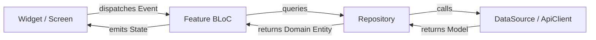

# TVMaze Stream - Flutter BLoC Application

[](https://flutter.dev)
[](https://dart.dev)
[](#architecture-overview)
[](https://bloclibrary.dev)
[](#test-suite--validation)

A production-grade, highly polished television exploration mobile application developed using **Flutter** and the **BLoC (Business Logic Component)** state management pattern, powered by the public [TVMaze REST API](https://www.tvmaze.com/api).

---

## Table of Contents
1. [Key Features](#key-features)
2. [Aesthetic & Design System](#aesthetic--design-system)
3. [Architecture Overview](#architecture-overview)
4. [Unidirectional Data Flow](#unidirectional-data-flow)
5. [Project Structure](#project-structure)
6. [Getting Started & Running Locally](#getting-started--running-locally)

---

## Key Features

- **Discover & Home Feed**:
  - Synthesized **"Trending Now"** horizontal carousel showcasing the top 10 highest-rated shows from the catalog with gradient overlays and rating badges.
  - Infinite-scrolling **"Popular Shows"** grid with page-by-page lazy loading (`/shows?page=X`) and `hasReachedMax` terminal guard.
  - Shimmer placeholder skeletons for zero layout pop-in.
  - Pull-to-refresh (`RefreshIndicator`) re-fetching from page 0.

- **Dynamic Debounced Search**:
  - Live query field with clear button.
  - **500ms reactive debounce transformer** via `rxdart` (`debounceTime` + `distinct` + `switchMap`) preventing API spam.
  - Dedicated initial guidance view ("Discover TV Shows"), empty zero-results state ("No shows found"), and error recovery views.

- **Comprehensive Show Details**:
  - Hero backdrop image with smooth top-to-bottom dark gradient fade.
  - Live metadata badges: star rating, premiered-ended years, running status, and network attribution.
  - HTML sanitizer utility safely stripping formatting from synopses.
  - **Concurrent multi-endpoint retrieval** via `Future.wait`: loads show metadata, cast members (`/shows/{id}/cast`), and episodes (`/shows/{id}/episodes`) in parallel.
  - Interactive **Season Selector** dropdown grouping episodes dynamically into sorted season buckets.
  - Cast tab displaying photos, real names, and character roles.

- **Offline Watchlist Persistence & Sync**:
  - Add or remove any show with a single tap from either the Details view or the Watchlist screen.
  - Offline persistence using `SharedPreferences` with JSON serialization under `watchlist_shows_v1` and corruption-resilient parsing.
  - App-level `WatchlistBloc` mounted above `MaterialApp` for real-time cross-screen synchronization.
  - Swipe-to-dismiss deletion with undo feedback, clear-all modal, and glowing empty state with an "Explore Shows" deep-link button.

---

## Aesthetic & Design System

The application features a modern dark aesthetic with neon violet accents:

| Token | Hex Value | Usage |
|---|---|---|
| `AppColors.background` | `#0F1016` | Global scaffold background |
| `AppColors.surface` | `#161822` | Navigation bar, modal sheets |
| `AppColors.surfaceVariant` | `#1E2030` | Search fields, chip containers |
| `AppColors.cardBg` | `#1A1B2E` | Show cards, episode tiles |
| `AppColors.primary` | `#8B5CF6` | Primary action buttons, active tabs |
| `AppColors.primaryLight` | `#A855F7` | Glowing accents, highlights |
| `AppColors.rating` | `#FBBF24` | Star rating badges |
| `AppColors.error` | `#EF4444` | Error states, destructive actions |

Modern typography is provided by `google_fonts` using **Poppins**.

---

## Architecture Overview

The codebase is structured following **Feature-First Clean Architecture**:

```
lib/
├── core/                       # Shared cross-cutting concerns
│   ├── constants/              # API endpoints, debounce timings, storage keys
│   ├── errors/                 # Typed exceptions (Network, Server, NotFound)
│   ├── network/                # ApiClient wrapping http with 15s timeout
│   ├── theme/                  # AppColors and AppTheme dark ThemeData
│   ├── utils/                  # HTML stripper, date formatters
│   └── widgets/                # Reusable UI primitives (Shimmer, ErrorView, RatingBadge)
│
└── features/                   # Autonomous feature modules
    ├── shell/                  # Persistent bottom navigation with IndexedStack
    ├── shows/                  # Home feed, trending carousel, popular shows grid
    ├── search/                 # Debounced search bar, live results, empty state
    ├── details/                # Show details, episode grouper, cast members
    ├── watchlist/              # Local storage, SharedPreferences data source, WatchlistBloc
    └── profile/                # Student credentials, live metrics, API attribution
```

Each feature adheres to a 3-layer architecture:
1. **Data Layer (`data/`)**: Models with JSON serialization, Remote/Local DataSources, and Repositories.
2. **Business Logic Layer (`bloc/`)**: BLoC, Events, and States inheriting from `Equatable`.
3. **Presentation Layer (`presentation/`)**: Screens, slivers, and modular reusable widgets.

---

## Unidirectional Data Flow

All state changes strictly adhere to BLoC's unidirectional data flow:



---

## Project Structure

```
tvmaze/
└── lib/
    ├── main.dart
    ├── core/
    │   ├── constants/app_constants.dart
    │   ├── errors/exceptions.dart
    │   ├── network/api_client.dart
    │   ├── theme/app_theme.dart
    │   ├── utils/html_utils.dart
    │   └── widgets/
    │       ├── app_network_image.dart
    │       ├── error_view.dart
    │       ├── info_chip.dart
    │       ├── rating_badge.dart
    │       └── shimmer_box.dart
    └── features/
        ├── shell/main_navigation_shell.dart
        ├── shows/
        │   ├── bloc/shows_bloc.dart, shows_event.dart, shows_state.dart
        │   ├── data/models/show.dart, show_parser.dart
        │   ├── data/datasources/shows_remote_datasource.dart
        │   ├── data/repositories/shows_repository.dart
        │   └── presentation/screens/home_screen.dart, widgets/
        ├── search/
        │   ├── bloc/search_bloc.dart, search_event.dart, search_state.dart
        │   ├── data/datasources/search_remote_datasource.dart
        │   ├── data/repositories/search_repository.dart
        │   └── presentation/screens/search_screen.dart
        ├── details/
        │   ├── bloc/show_details_bloc.dart, show_details_event.dart, show_details_state.dart
        │   ├── data/models/episode.dart, cast_member.dart
        │   ├── data/datasources/details_remote_datasource.dart
        │   ├── data/repositories/details_repository.dart
        │   └── presentation/screens/show_details_screen.dart
        ├── watchlist/
        │   ├── bloc/watchlist_bloc.dart, watchlist_event.dart, watchlist_state.dart
        │   ├── data/models/watchlist_show.dart
        │   ├── data/datasources/watchlist_local_datasource.dart
        │   ├── data/repositories/watchlist_repository.dart
        │   └── presentation/screens/watchlist_screen.dart
        └── profile/
            └── presentation/screens/profile_screen.dart
```

---

## Getting Started & Running Locally

### Prerequisites
- [Flutter SDK](https://flutter.dev/docs/get-started/install) (>= 3.0.0)
- Dart SDK (>= 3.0.0)

### 1. Clone & Fetch Dependencies
```bash
git clone <repository-url>
cd tvmaze
flutter pub get
```

### 2. Launch the Application
```bash
flutter run
```